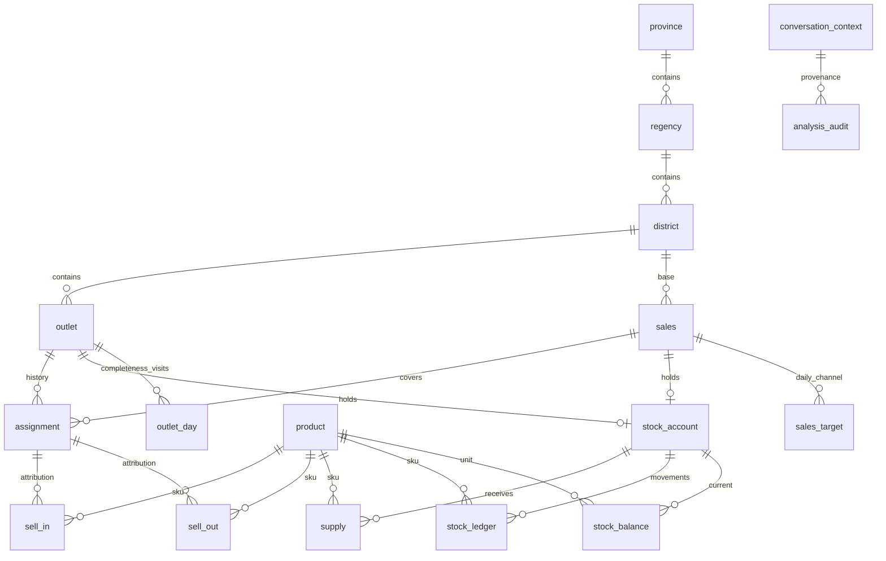

# ERD PostgreSQL

`reversal(channel,transaction_id)` → sell_in/sell_out dan `stock_ledger(source_kind,source_id)` → supply/sell_in/sell_out/reversal adalah relasi polimorfik yang dijaga trigger posting, permission serta audit SQL, bukan FK native. Tidak digambar sebagai FK palsu. Setiap sell-in memiliki dua ledger legs; sell-out/supply satu; reversal menegasikan legs transaksi asal. Unique `(source_kind,source_id,leg)` mencegah posting ganda.

| Tabel | Grain / PK | Aturan penting |
|---|---|---|
| province, regency, district | id integer; code unik | FK hierarki; kode FX fiktif |
| outlet | id; code unik | district FK; alias owner fiktif; opened inclusive, closed exclusive; map_url generated |
| sales | id; code unik | kecamatan basis bukan otomatis seluruh cakupan otorisasi |
| assignment | id; outlet+sales FK | interval `[valid_from,valid_to)`; overlap per outlet ditolak dengan row lock outlet; append-only |
| product | id; SKU unik | PERDANA/VOUCHER PCS; SALDO IDR; harga numeric bukan float |
| stock_account | id | tepat satu sales_id atau outlet_id; pemegang unik |
| stock_balance | account+product | kuantitas >=0; cache ledger, bukan input manual |
| supply | id; external_key unik | penerimaan eksternal/top-up/opening terkontrol, quantity>0 |
| sell_in | id; external_key unik | stok sales→outlet; FK assignment snapshot; harga saat transaksi |
| sell_out | id; external_key unik | stok outlet→konsumen; SYN customer token tanpa PII |
| reversal | id identity | tepat satu full reversal per channel+transaction; timestamp >= asal; tidak ada partial return |
| stock_ledger | id identity | append-only; sumber/leg unik, delta !=0; PCS integer |
| sales_target | sales+date+channel | target omzet positif; channel wajib, rationale disimpan |
| outlet_day | outlet+date | status input, jam buka harapan, kunjungan, observasi stockout nullable |
| ingestion_watermark | source | complete_through dan batch_key; bukan MAX tanggal transaksi |
| conversation_context | opaque id | principal, scope, metric, periode, evidence, TTL dan optimistic version |
| analysis_audit | id identity | context, tool, params, evidence digest, timestamp |
| inbound_event | provider+message_id | dedup WhatsApp, principal, payload hash, processing state |
| outbox | id; idempotency_key unik | intent pesan keluar, retry state/attempt; bukan jaminan exactly-once provider |

Semua harga dan revenue IDR tanpa pajak; `net_revenue=round(quantity*unit_price-discount_idr,2)`. Saldo Rp10.000 direpresentasikan quantity=10000 dan harga per rupiah, misalnya 1.0100. Ini adalah nilai top-up dijual, bukan margin/komisi operator atau pendapatan akuntansi audited.

Penjualan selesai bersifat append-only. Koreksi melalui reversal penuh dan transaksi pengganti. Pembatalan sell-in ditolak bila stok outlet tidak cukup untuk dikembalikan. Jangan menghapus transaksi untuk membetulkan input. Pembatalan saldo hanyalah skenario demo internal: di produksi, konfirmasi reversal operator terlebih dulu dan jangan otomatis mengembalikan saldo tanpa bukti.

Tidak ada serial number SIM/voucher, expired lot, hutang/piutang, komisi, invoice multi-line, retur parsial, alih stok antarsales, atau integrasi operator nyata. Bila ditambah, buat event ledger dan migration baru dengan aturan unit serta audit yang sama; jangan memakai receipt sebagai jalan pintas transfer tanpa jejak.
